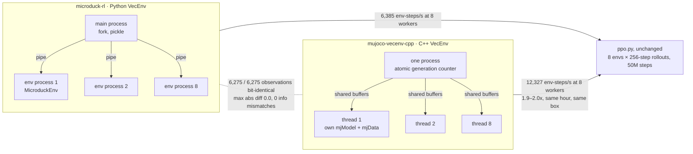

# mujoco-vecenv-cpp

Threaded MuJoCo vector environment in C++ that returns the same observations, rewards and flags as the Python reference, bit for bit (6,275 / 6,275 observations), at 1.93x the Python env-steps/s on 8 workers.



| method | metric | value | condition |
|---|---|---|---|
| C++ env vs Python env | observations bit-identical | 6,275 / 6,275 (100.00%), max abs diff 0.0e+00, 0 info mismatches | 25 episodes, both reward versions, latency 0/2, noise 0/0.02, two held-out variants, two DR cases, sensor noise off |
| Python processes vs C++ threads | env-steps/s at 8 workers | 6,385 vs 12,327, 1.93x | random actions, same hour, `compare_main.json`; contended rerun 6,668 vs 13,612, 2.04x |
| C++ sweep, `env` mode | env-steps/s, 1 → 8 threads | 5,639 → 20,287, 3.60x, 45% efficiency | `groundcontact`, reward v2, stable reference |
| C++ sweep, `bare` mode | env-steps/s, 1 → 8 threads | 5,404 → 27,011, 5.00x, 62% efficiency | 10 × `mj_step`, TRENDING verdict, rows reproduced within 1% |
| C++ sustained, 8 threads | plateau band | 13,329–16,238 (22% band), peak 20,829 | 18 × 20 s windows, `env` mode |
| PPO 50M, C++ env | return of 500 · survival | 339.4 ± 2.3 · 0.94 ± 0.06 | 3 training seeds, evaluated on the Python env, 100 episodes × 5 eval seeds |
| PPO 50M, Python env | return of 500 · survival | 348.1 ± 8.1 · 0.87 ± 0.14 | same protocol |
| PD hold-pose | return of 500 | 175.8 ± 0.2 | baseline, no learning |
| PPO 50M wall-clock | C++ vs Python | 3.1 h vs 4.0–4.4 h, 1.25x–1.43x | per training seed, same laptop |
| Tests | C++ · Python · CI | 38 cases / 417,507 assertions · 86 tests · ASan+UBSan and TSan | every commit, microduck-rl pinned |

## Quick start

Linux, C++17 compiler, CMake ≥ 3.18, Python ≥ 3.8, CPU only. Needs [microduck-rl](https://github.com/AungKaung1928/microduck-rl) next to this repo (the robot meshes are fetched by its script, never committed).

```bash
git clone https://github.com/AungKaung1928/microduck-rl.git ../microduck-rl   # first time only
(cd ../microduck-rl && ./fetch_assets.sh)                                     # first time only
git clone <this repo URL>
cd mujoco-vecenv-cpp
python3 -m venv .venv && . .venv/bin/activate && pip install -r requirements.txt   # first time only
cmake -S . -B build -DCMAKE_BUILD_TYPE=Release && cmake --build build -j4
./build/vecenv_tests && python -m pytest tests/py -q
python scripts/contract_report.py   # the equality table: max abs diff 0.0, 14 s on one laptop core
```

`./verify.sh` runs the same steps in order. Sanitizer builds, the PPO run and the Python API: [docs/RESULTS.md](docs/RESULTS.md#reproducing).

## How it works

One `mjModel` + `mjData` per environment, N environments on T threads of one process, workers released by an atomic generation counter and writing into shared buffers. A pybind11 module exposes a drop-in `VecEnv`, so microduck-rl's `ppo.py` runs unchanged. Bit equality needed numpy's pairwise mean and libm `pow` reproduced in C++; how each mismatch was found is in [docs/RESULTS.md](docs/RESULTS.md#what-had-to-be-matched-and-how-it-was-found).

## License

MIT. `third_party/doctest/doctest.h` is MIT (Viktor Kirilov). MuJoCo is Apache-2.0, used through its pip wheel. The Microduck model and meshes belong to Pollen Robotics (code Apache-2.0, 3D files CC BY-SA-NC) and are fetched, never redistributed, by microduck-rl.
